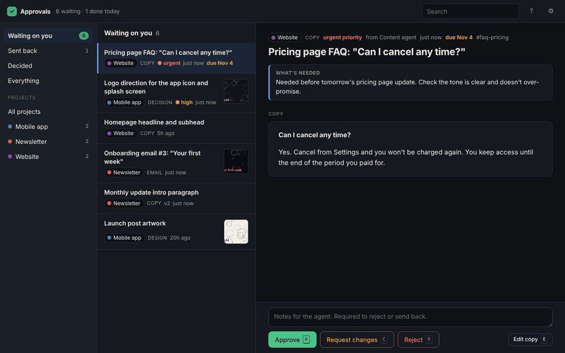
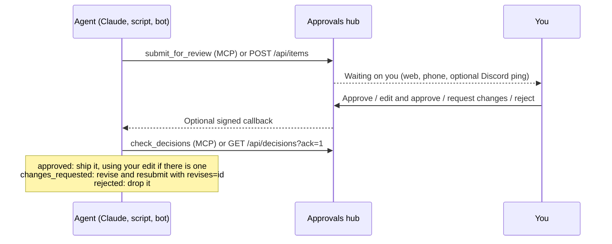

# Approvals hub

A review queue for AI agents. Agents submit work over MCP or REST: artwork, copy, emails, either-or decisions. You approve it, edit it, or send it back with a note, from your desk or your phone. The agent picks up your decision on its next run and carries on.



## Why I built it

I'm the only engineer at [FinalPeace](https://finalpeace.co). A team of AI agents does the work of a ten-person team across development and marketing: ads, emails, landing pages and product fixes. The bottleneck stopped being the work and became me. Agents would stop mid-task to ask a question in a chat I wasn't looking at, or ship something I'd have changed.

So every agent sends finished work here instead, keeps going on something else, and checks back for my answer. I approve what they ship in about half an hour a day. The same hub serves agents across my other projects, each with its own key.

## How it works



- **Agents never block on you.** They submit and move on. Decisions are pulled with `check_decisions`, so an agent that only wakes up on a schedule works the same as one that's always running. Each decision is handed out once, then marked as picked up.
- **Your edits are the decision.** For copy and emails you can rewrite the text and approve your version. The agent gets it back as `revised_content` and is told to use it word for word.
- **Revisions keep their history.** A resubmission with `revises=<id>` replaces the earlier version in your queue and shows your previous note next to the new draft.

## Quick start

With Docker:

```bash
git clone https://github.com/adamblazer18/approvals-hub && cd approvals-hub
ADMIN_PASSWORD=pick-something-long docker compose up -d
# open http://localhost:3060
```

With Node 22 or later (no native build step; storage is the built-in `node:sqlite`):

```bash
cp .env.example .env      # set ADMIN_PASSWORD
npm install
npm run seed:demo         # optional: sample items to click through
npm start                 # http://localhost:3060
```

## Connecting an agent

Create one key per agent under **Settings → Agent keys** (or `npm run create-key -- "Website agent" "Website"`). A key can be locked to a single project. Keys are stored as SHA-256 hashes and shown once.

**Claude Code**

```bash
claude mcp add --transport http approvals https://your-hub.example.com/mcp/apk_...
```

**Claude apps (custom connector):** paste `https://your-hub.example.com/mcp/apk_...` under Settings → Connectors. Any other MCP client can use `https://your-hub.example.com/mcp` with `Authorization: Bearer apk_...`.

The server sends agents instructions on how to handle each decision. One line in an agent's prompt is usually enough:

> When something needs sign-off, submit it with `submit_for_review` and keep working on other things. At the start of every run, call `check_decisions` and act on each one.

| MCP tool | What it does |
|---|---|
| `submit_for_review` | Adds an item to the queue. Images and files as URLs or base64. |
| `check_decisions` | Returns new decisions and marks them picked up. Filter by `external_ref` to match your task. |
| `list_pending` | What's already waiting, to avoid duplicates. |
| `get_item` | One item with its earlier versions and notes. |
| `withdraw_item` | Removes an item that's no longer needed. |
| `list_projects` | Projects with pending counts. |

**REST, for scripts and bots**

```bash
curl -X POST https://your-hub.example.com/api/items \
  -H "Authorization: Bearer $KEY" -H 'content-type: application/json' -d '{
    "project": "Website", "kind": "copy", "title": "Homepage headline",
    "summary": "Current version is underperforming on signups.",
    "body": "# Your week, planned before Monday",
    "external_ref": "task-123", "callback_url": "https://your-agent.example.com/hooks/approvals"
  }'

curl -H "Authorization: Bearer $KEY" 'https://your-hub.example.com/api/decisions?ack=1'
```

Multipart uploads work too (`-F files=@option-a.png`). Item fields: `project` and `title` are required; `kind` is `design`, `copy`, `email`, `decision` or `other`; plus `summary`, `body`, `body_format`, `email_to`, `email_subject`, `options`, `attachments`, `links`, `priority`, `due_at`, `external_ref`, `revises`, `agent` and `callback_url`.

A decision comes back in this shape, over MCP, REST or the callback:

```json
{ "id": "k0xwi87O", "project": "website", "title": "Homepage headline", "status": "approved",
  "note": null, "revised_content": "# Your week, planned before Monday", "chosen_option": null,
  "external_ref": "task-123", "version": 1, "decided_at": "2026-11-03T18:02:11.000Z", "url": "..." }
```

## Reviewing

The queue is sorted by priority, then due date, then age, and filters by project. Each item shows what the agent needs from you, the content itself (image gallery, rendered email, formatted copy, video, PDF), its links and your notes on earlier versions. Approving a multiple-choice item requires picking an option; rejecting or sending back requires a note, because the agent needs something to act on.

It's built to be fast from the keyboard: `j`/`k` to move, `a` approve, `c` request changes, `r` reject, `1`–`9` pick an option, `e` edit copy, `u` undo, `?` for the rest. It works on a phone.


## Security model

This is a single-reviewer tool, meant to sit behind HTTPS on your own server.

- One reviewer password, compared in constant time, with a growing delay after failed attempts. Sessions are HMAC-signed cookies (`httpOnly`, `sameSite=lax`).
- Agent keys are random 192-bit tokens stored only as hashes. A key can be scoped to one project, and it can submit, read and withdraw but never decide. Only the reviewer can approve.
- Uploaded files are served only to the reviewer or a valid key. SVGs get a restrictive Content-Security-Policy. Markdown and HTML bodies are sanitized with DOMPurify before rendering.
- Decision callbacks are signed: `x-approvals-signature: sha256=<HMAC of the exact body>` when `WEBHOOK_SECRET` is set. Callback URLs must be http(s).
- The key-in-URL form (`/mcp/apk_...`) exists because some MCP connectors can't set headers. Treat that URL like the key itself. Prefer the `Authorization` header where your client supports it.

## Design notes

- **SQLite through `node:sqlite`.** One file, no native build, backups with `sqlite3 .backup`. It runs as a single process on purpose.
- **Stateless MCP.** Each request builds a fresh MCP server over Streamable HTTP with JSON responses, so there's no session state to lose on restart and it sits happily behind any reverse proxy.
- **Pull, then optionally push.** Agents poll `check_decisions` with acknowledgement, which works for scheduled agents that can't receive webhooks. Callbacks are there for the ones that can.
- **Every change is an event.** Submissions, decisions, reopenings and pickups are written to an events table, so you can see what an agent did with your answer.

## Deploying

`docker compose up -d` behind any HTTPS proxy is the simplest route. For a plain Linux server with nginx and PM2, `deploy/install.sh` installs the app, writes `.env` with generated secrets and adds the nginx site (`DOMAIN=approvals.example.com bash deploy/install.sh`). `deploy/backup.sh` keeps 14 days of nightly database and upload backups.

## Development

```bash
npm test
```

The tests start the hub on a random port with a throwaway database and cover the full loop over REST and over a real MCP client: submit, decide, pick up once, revisions, option choices, project-scoped keys, revoked keys, upload access and callback signatures. CI runs them on Node 22 and 24.

## License

MIT
